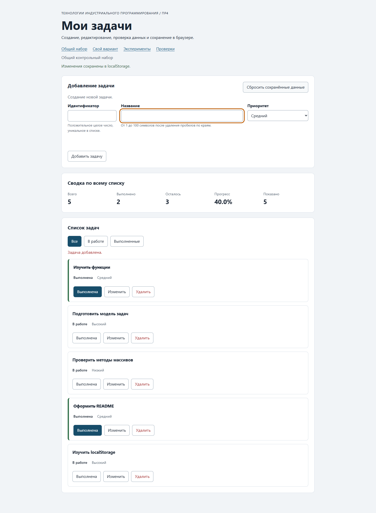
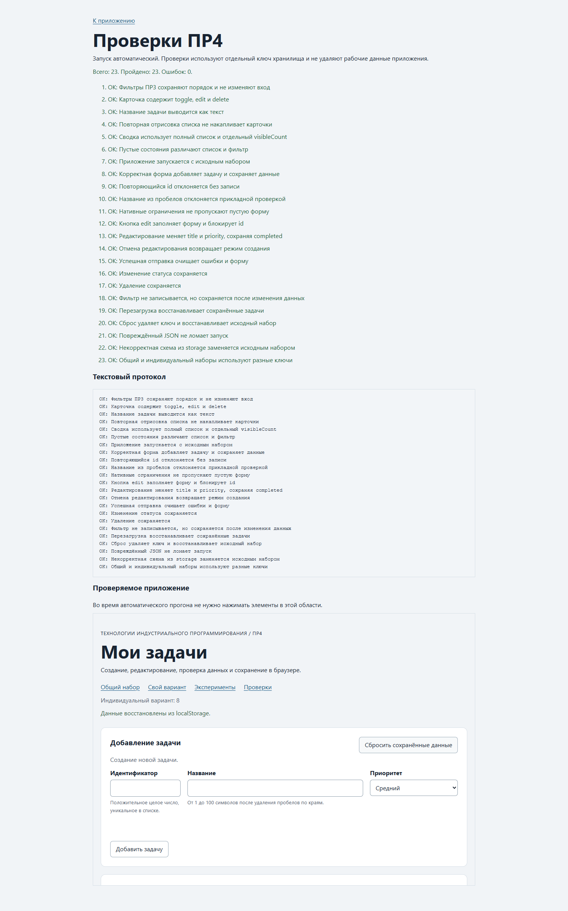

# Отчёт по практической работе № 4

**Тема:** Формы, валидация и локальное хранение данных  
**Выполнил:** Велиханов Ашурбег Мадрудинович  
**Группа:** ЭФБО-17-25  
**Вариант:** 8 — оформление технической документации

## Цель работы

Создать браузерное приложение для добавления, редактирования, удаления и фильтрации задач. Данные формы проверяются до изменения состояния, а список сохраняется в `localStorage` и восстанавливается после перезагрузки.

## Окружение и запуск

- Windows 11 10.0.22000;
- Node.js v24.22.1;
- Google Chrome 156.0.8078.76.

```bash
npm test
npm start
```

Приложение: `http://127.0.0.1:5504/`. Вариант 8: `http://127.0.0.1:5504/?dataset=variant`.

## Реализация

- `task-service.js` содержит чистые операции над неизменяемым массивом задач;
- `form-validation.js` нормализует `id`, `title` и `priority`, проверяет границы и уникальность;
- `task-storage.js` сохраняет объект `{ version: 1, tasks }`, проверяет схему при чтении и безопасно возвращается к исходным данным при ошибке;
- `main.js` связывает форму, фильтры, карточки, редактирование и сохранение;
- общий и индивидуальный наборы используют разные ключи хранилища.

## Результаты проверок

| Набор | Результат |
|---|---:|
| Сервисные проверки | 35 из 35 |
| Проверки модулей ПР4 | 27 из 27 |
| Браузерные проверки | 23 из 23 |

Проверены дополнительные случаи: название длиной 100 символов принимается, повреждённый JSON приводит к безопасному восстановлению, а общий и индивидуальный наборы сохраняются независимо.





## Индивидуальный вариант

Исходные id: `[11, 23, 37, 41, 58, 64]`. Добавлена задача 75, задача 23 отредактирована, задача 37 удалена. После изменения остаётся шесть задач, две из них выполнены, прогресс составляет `33.3%`. Перезагрузка восстанавливает изменения, а сброс возвращает исходный набор.

## Вывод

Форма и прикладная валидация предотвращают некорректные изменения. Версионированная запись в `localStorage` сохраняет состояние между перезагрузками и позволяет безопасно обрабатывать повреждённые данные.
