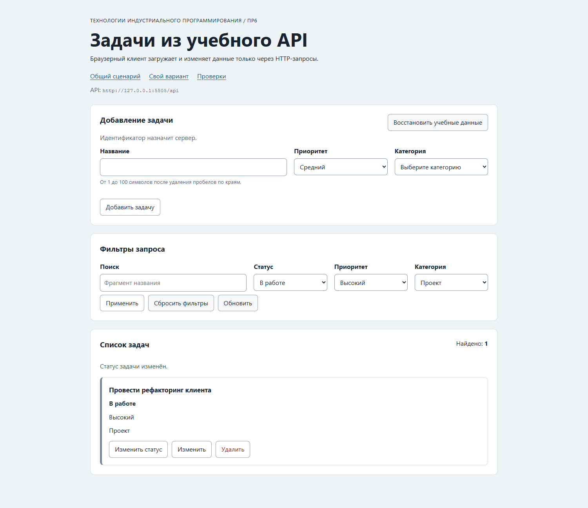

# Отчёт по практической работе № 6

**Тема:** Подключение браузерного приложения к API  
**Выполнил:** Велиханов Ашурбег Мадрудинович  
**Группа:** ЭФБО-17-25  
**Вариант:** 8

## Цель работы

Подключить браузерный интерфейс к учебному API и реализовать загрузку, фильтрацию, создание, редактирование, изменение статуса, удаление и сброс задач через HTTP-запросы.

## Окружение и запуск

- Windows 11 10.0.22000;
- Node.js v24.22.1;
- Google Chrome 156.0.8078.76.

```bash
npm test
npm start
```

API: `http://127.0.0.1:5505/api`. Приложение: `http://127.0.0.1:5506/`.

## Архитектура

- `api-client.js` поддерживает GET, POST, PATCH и DELETE, JSON-тело, тайм-аут и отмену;
- `task-api.js` проверяет схемы и предоставляет предметные CRUD-методы;
- `app-controller.js` хранит текущее состояние, отменяет устаревшие загрузки и после мутации повторяет GET с текущими фильтрами;
- `dom-app.js` отвечает только за DOM и события;
- `task-view.js` безопасно выводит пользовательский текст через `textContent`.

## Результаты проверок

| Набор | Результат |
|---|---:|
| Контракт API | 23 из 23 |
| Модульные проверки | 33 из 33 |
| Интеграционные проверки | 14 из 14 |
| Всего Node.js-проверок | 70 из 70 |

Дополнительно вручную проверены создание задачи с серверным id, фильтры, редактирование, смена статуса, удаление, сброс и обработка недоступного API.

## Индивидуальный вариант

Начальный фильтр варианта 8:

```js
{ completed: false, priority: "high", categoryId: 2 }
```

До изменения видны задачи `[4, 34]`. После завершения задачи 4 сервер получает `PATCH /api/tasks/4`, затем выполняется повторный `GET` с теми же фильтрами; задача 4 исчезает, остаётся задача 34.



## Вывод

Состояние интерфейса синхронизируется с сервером после каждого изменения. Отмена устаревших запросов предотвращает появление старых данных, а структурированные сообщения позволяют различать сетевые, HTTP- и форматные ошибки.
